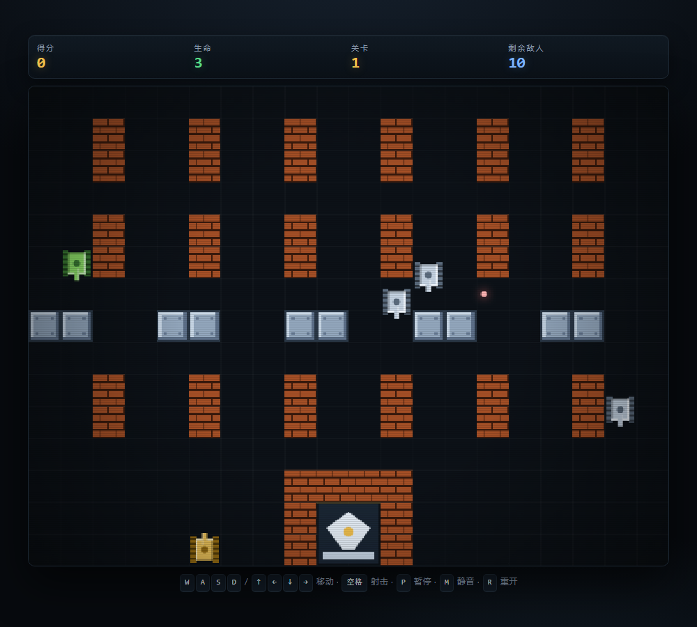

# 坦克大战 · Tank Battle

一个致敬 FC《Battle City》的网页坦克游戏，纯原生 **HTML + CSS + JavaScript + Canvas 2D** 实现，
**零依赖、零构建、零安装** —— 双击 `index.html` 就能玩。

守住画面底部的基地（老鹰），消灭关卡内全部敌军即可过关。



## 玩法

- 你是画面下方那辆黄色坦克，基地（老鹰）在城市中央偏下的位置。
- 敌军会从画面上方三个出生点不断出现，共 3 关，每关 10～14 辆敌军坦克。
- **基地被摧毁** 或 **生命耗尽** 即游戏结束。
- 击毁敌军、吃到道具都会加分，最高分保存在浏览器本地。

## 操作

| 按键 | 功能 |
| --- | --- |
| `W` `A` `S` `D` / `↑` `←` `↓` `→` | 移动 |
| `空格` / `J` / `K` | 发射炮弹 |
| `P` | 暂停 / 继续 |
| `M` | 静音开关 |
| `R` | 游戏结束后重开 |
| `Enter` | 开始游戏 |

手机、平板等触屏设备会自动显示屏幕上的方向键与发射按钮。

## 地形与道具

| 地形 | 说明 |
| --- | --- |
| 🧱 砖墙 | 可被任何炮弹击穿，打一炮少一格 |
| ⬜ 钢墙 | 普通炮弹打不穿，满级火力（吃 3 个 ★）才能摧毁 |
| 🌊 河流 | 坦克无法通过，但炮弹可以飞越 |
| 🌳 树林 | 坦克与炮弹都能通过，但会遮住坦克（看不见敌人） |
| 🦅 基地 | 被击中即游戏结束，四周有砖墙保护 |

击毁闪烁的敌军坦克会掉落道具，走过去即可拾取：

| 道具 | 效果 |
| --- | --- |
| `S` 护盾 | 8 秒无敌护盾 |
| `★` 火力 | 提升玩家等级（射速 → 双发 → 击穿钢墙） |
| `♥` 生命 | 生命 +1 |
| `B` 炸弹 | 立即摧毁场上全部敌军 |
| `F` 冻结 | 敌军停止行动 7 秒 |

## 敌军类型

| 类型 | 特征 | 分值 |
| --- | --- | --- |
| 普通（银灰） | 速度与射速均衡 | 100 |
| 快速（绿色） | 移动速度约为普通的两倍 | 200 |
| 火力（黄色） | 炮弹更快、射速更高 | 300 |
| 装甲（红色） | 需要命中 3 次才摧毁，颜色随血量变暗 | 400 |

## 目录结构

```
.
├── index.html          # 页面结构
├── css/
│   └── style.css       # 街机风样式、响应式与触屏控制
├── js/
│   └── game.js         # 游戏引擎：地图、碰撞、AI、渲染、音效
├── assets/
│   └── icon.svg        # 站点图标
├── docs/
│   └── screenshot.png  # 截图
├── LICENSE
└── README.md
```

## 本地运行

方式一：直接双击 `index.html`。

方式二：起一个静态服务器（推荐，行为与线上一致）：

```bash
# Python 3
python -m http.server 8000

# 或 Node.js
npx serve .
```

然后打开 <http://localhost:8000>。

## 实现要点

- **14 × 20 网格地图**：关卡用 ASCII 字符绘制，一眼看懂、改起来方便。
- **像素级连续移动**：坦克按方向做 2px 步进碰撞检测，转向时自动吸附格心，狭窄通道也能顺畅通过。
- **分步子弹检测**：高速炮弹按 4px 分步推进，避免穿过薄墙。
- **敌军 AI**：以“冲基地 / 追玩家”为目标选择方向，撞墙后重新规划，并在瞄准玩家或基地时开火。
- **音效零素材**：全部由 WebAudio 实时合成（方波 + 噪声），不加载任何音频文件。
- **响应式**：Canvas 逻辑分辨率固定 640×480，由 CSS 等比缩放，桌面与手机共用一套代码。

## 调试参数

开发时可以在 URL 上附加参数，方便定位问题：

| 参数 | 作用 |
| --- | --- |
| `?play` | 跳过开始界面直接开局 |
| `?level=2` | 从第 2 关开始（1～3） |
| `?sim=15` | 快进模拟 15 秒再渲染，便于自动截图 |

控制台里还可以通过 `window.TankBattle` 访问游戏状态（`state`、`update`、`startGame` 等）。

## 许可

[MIT](LICENSE)
